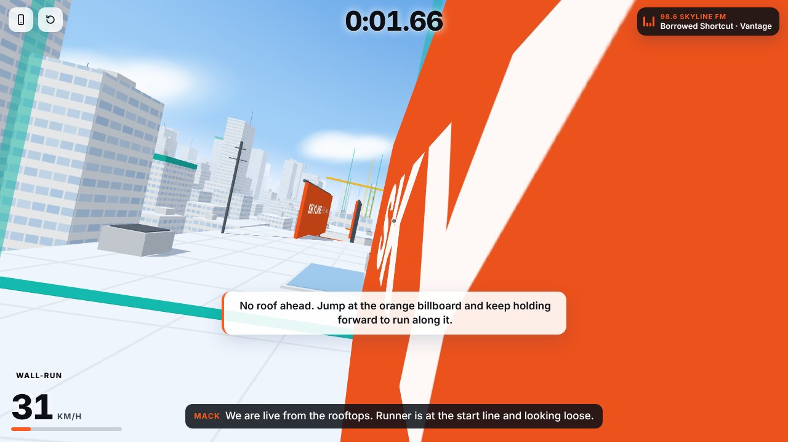
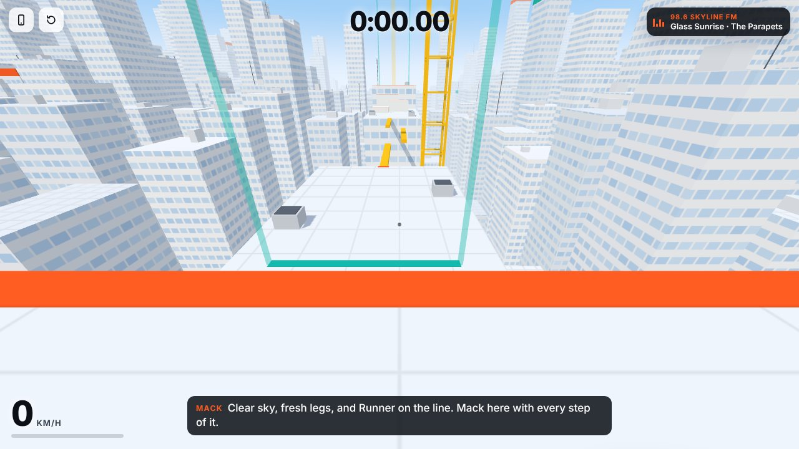
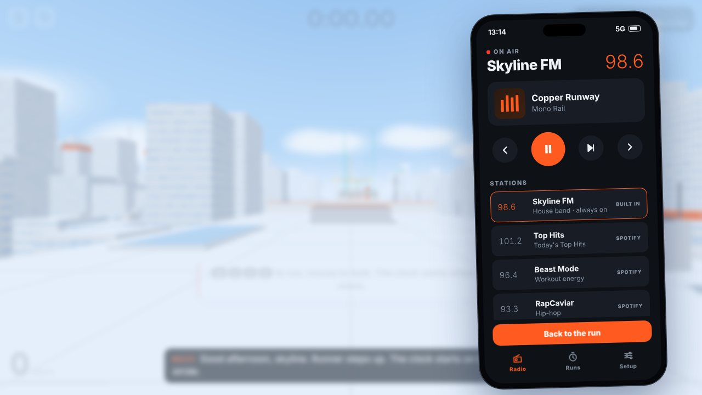

# Skyline FM

First-person rooftop parkour in the browser, with a phone in your pocket that's tuned to the radio. A DJ talks between the tracks and a commentator calls every move you make, live.

**Play it:** https://r00zl.github.io/skyline-fm/



| | |
|---|---|
|  |  |

## How to play

Get from the start roof to the helipad as fast as you can. Vaults and ledge grabs happen on their own; you just keep running and pick your moment to jump.

| | Keyboard and mouse | Touch | Gamepad |
|---|---|---|---|
| Run | `W` `A` `S` `D` | left thumb | left stick |
| Look | mouse | right thumb | right stick |
| Jump / wall-jump | `Space` | JUMP | A |
| Slide / roll | `Shift` (or `C`) | SLIDE | B or RB |
| Phone and radio | `Tab` | tap the radio chip | Y |
| Back to checkpoint | `R` | ↺ button | Back |
| Restart the run | `T` | in the phone, under Runs | |
| Change station | `[` `]` | in the phone | |
| Play/pause, skip | `M`, `N` | in the phone | |

Moves:

- **Vault**: run straight at anything waist-high.
- **Climb**: jump at a ledge and keep pushing forward. Hold jump against a taller wall to kick a little higher first.
- **Wall-run**: jump at an orange billboard and keep holding forward. Jump again to kick off it.
- **Slide**: hold slide while running. It's the only way under the ducts.
- **Roll**: hold slide as you land from a long drop, or you lose your speed.
- **Flow**: chaining moves fills the bar under your speed and raises your top speed.

## The radio

Open the phone to see the dial.

- **98.6 Skyline FM** is built in. The "house band" is a small generative synth group, so there is always music with no sign-in, and the DJ can introduce every track by name.
- The **Spotify stations** play through Spotify's own embedded player, which needs no developer account or key. If you're signed in to Spotify in the same browser you get full tracks; otherwise Spotify plays previews. Browsers sometimes block the first play, in which case open the phone and tap play once.
- **My station** takes any Spotify playlist, album, track, artist or podcast link.

### Spotify Premium mode (optional, untested)

With Premium and a Spotify developer app, the Spotify stations play through the Web Playback SDK instead of the embed. That adds skip, music that dips while someone is talking, and artist names for the DJ when you use the device voices.

1. Create an app at https://developer.spotify.com/dashboard and tick **Web API** and **Web Playback SDK**.
2. Add this exact redirect URI to it: `https://r00zl.github.io/skyline-fm/` (the phone's Setup tab shows the right address for wherever the game is hosted, with a copy button).
3. Paste the app's client ID into **Setup → Spotify Premium** and press **Connect Spotify**.

Things to know before you rely on it:

- This path was written from Spotify's documentation but **has not been run against a real client ID**, so expect to shake out a bug or two the first time.
- Since February 2026 a development-mode app needs its owner to have Premium, and only five named Spotify accounts can use it. Add each account under the app's user management page.
- Some developers have reported the Web Playback SDK failing to connect for development-mode apps since those changes. If that happens the game says so and carries on with the embedded player.
- The login uses the PKCE flow, so there is no client secret anywhere. Tokens are kept in this browser's local storage; **Disconnect** removes them.

## The DJ and the commentator

Two voices share the airwaves, and both are driven by what actually happens:

- **Mack** calls the run: vaults, wall-runs, clutch ledge grabs, hard landings, combos, splits against your best, falls (and how many times you've fallen at the same spot), and the finish.
- **Nova** is the DJ: she signs on, introduces tracks, reacts when you change station, and drops in between songs with your fall count, best combo, top speed, or just the time.

Everything they say comes from the line bank in [`js/lines.js`](js/lines.js), filled in with live numbers.

### The voices

Mack and Nova speak with **recorded clips** in `voice/`, about 700 short MP3s made ahead of time with the open-source [Kokoro](https://huggingface.co/hexgrad/Kokoro-82M) speech model (Apache 2.0). Nothing is generated while you play, there are no API keys, and they sound the same on every device. Lines with a live time in them ("1 minute, 12.3 seconds") are spliced together from separate clips.

Two things a recording can't do: say your name (the recorded voices call you "our runner") and read out a real song title from Spotify. If you'd rather have those, switch **Setup → Voices** to "This device's voices", which uses the browser's built-in speech. Those are more robotic, especially on iPhone, where web pages only get Apple's basic voices. Any line that has no clip falls back to the device voice on its own.

To change what they say:

1. Edit `js/lines.js`. The comment at the top explains the `{placeholders}` and the `|` splice marks.
2. Regenerate the clips (only new lines are generated):

```sh
pip install kokoro-onnx soundfile numpy
# model files (about 350 MB) from https://github.com/thewh1teagle/kokoro-onnx/releases/tag/model-files-v1.0
node tools/voice-lines.mjs > lines.json
python3 tools/make-voices.py --model kokoro-v1.0.onnx --voices voices-v1.0.bin --lines lines.json --out build/wav
node tools/encode-voices.mjs build/wav voice lines.json     # needs ffmpeg
```

`make-voices.py` takes `--mack` and `--nova` to try other Kokoro voices (delete `build/wav` first to redo every clip). To make them react to something new, emit an event on the bus and add a handler in `js/dj.js`.

## Run it locally

It's a static site with no build step, but it uses ES modules, so it needs a web server rather than opening the file directly:

```sh
python3 -m http.server 8000
# then open http://127.0.0.1:8000
```

Add `?cp=3` to the address to start a practice run from checkpoint 3 (practice runs don't count toward your best).

There is a headless check that the course can be finished. A simple bot runs it using the real physics:

```sh
node test/bot.mjs            # add --verbose for the move-by-move log
```

## How it's put together

| File | What it does |
|---|---|
| `js/course.js` | The course as plain data: boxes, checkpoints, triggers |
| `js/player.js` | Movement and parkour physics (no rendering, so it runs under Node) |
| `js/world.js` | three.js scene: instanced buildings, sky, lighting, signage |
| `js/input.js` | Keyboard, mouse, touch and gamepad |
| `js/audio.js` | Synthesised sound effects and the house band |
| `js/radio.js`, `js/spotify.js` | Stations, the Spotify embed, and Premium sign-in and playback |
| `js/dj.js`, `js/lines.js`, `js/speech.js` | Mack and Nova: what they say and when |
| `voice/`, `tools/` | The recorded voice clips, and the scripts that generate them |
| `js/phone.js`, `js/hud.js` | The phone and the on-screen display |
| `js/main.js` | Game state and the frame loop |

Rendering uses [three.js](https://threejs.org/) (MIT), vendored in `vendor/`. The voice clips were generated with Kokoro-82M (Apache 2.0) via kokoro-onnx (MIT). Spotify and its playlists belong to Spotify; this project is not affiliated with them.
